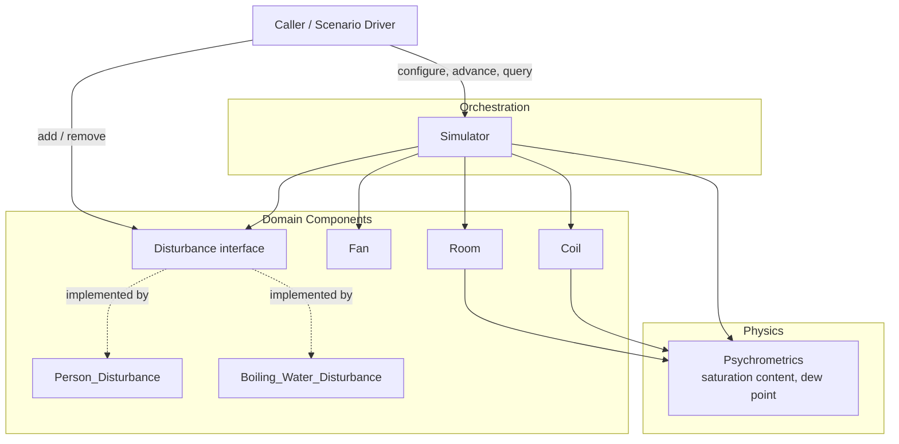
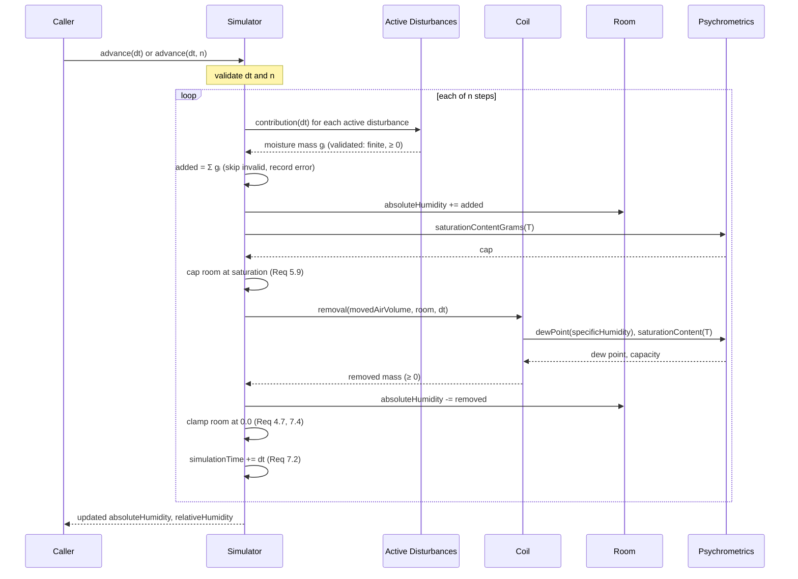
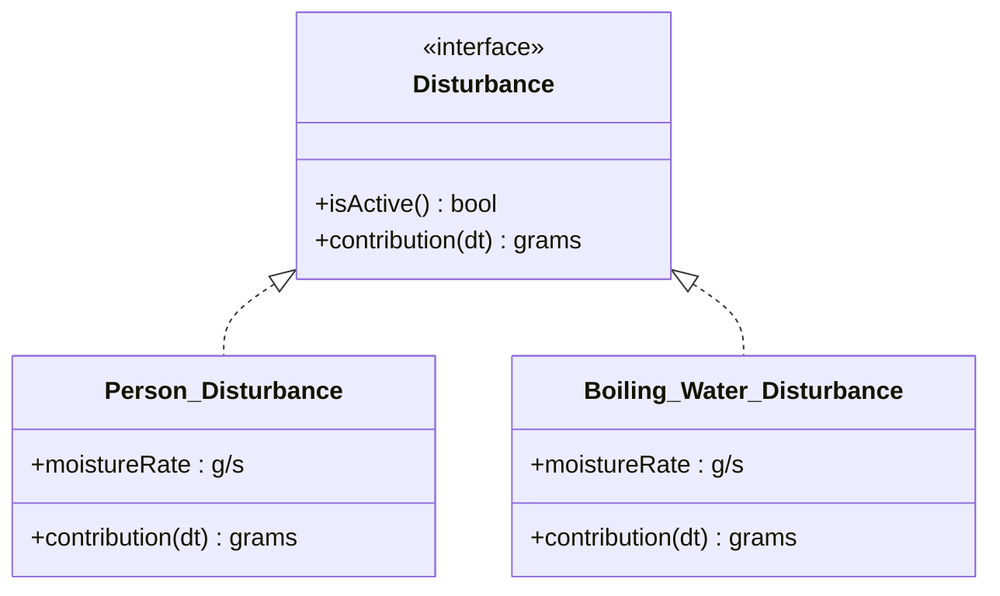
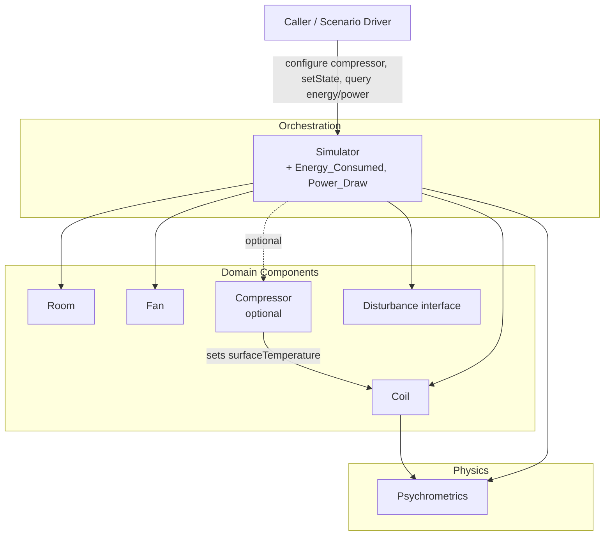

# Design Document

## Overview

The Room Humidity Simulator is a time-stepped simulation engine that models how moisture in a single enclosed room evolves under three coupled mechanisms: moisture-injecting disturbances (people, boiling water), a fan that drives airflow across a condensing coil, and the coil itself, which removes moisture from the moved air. The engine advances in discrete, fixed-duration time steps and, at each step, applies a strict update order: disturbance additions first, then coil removal, then room-state update.

The design keeps physics, component state, and orchestration cleanly separated so that new disturbance types can be injected through a common interface without touching the coil, fan, or simulator internals (Requirement 6). All public humidity values are reported as non-negative, saturation-capped quantities, preserving the two cross-cutting invariants that run through the requirements: absolute humidity never goes below `0.0 g` (Requirements 4.7, 7.4) and never exceeds the temperature-dependent saturation capacity (Requirements 2.3, 5.9).

### Goals

- Model absolute humidity (mass of water vapor, in grams) as the single source of truth for room moisture, with relative humidity derived on demand.
- Advance simulation deterministically in fixed time steps with an explicit, documented update order.
- Validate all configuration at construction/mutation time and reject out-of-range values with descriptive errors, leaving prior valid state unchanged.
- Allow arbitrary disturbances to be injected through a common interface (open/closed to new disturbance types).
- Preserve the non-negative and saturation-capped humidity invariants at every observable point.

### Non-Goals

- No specific programming language, UI, or persistence mechanism is prescribed (these are left to implementation).
- No multi-room or spatial modeling; the room is a single well-mixed control volume.
- No modeling of temperature dynamics driven by the coil or disturbances; room temperature is a configured constant for a run (it may be changed via configuration, which triggers recomputation per Requirement 2.2).

### Key Design Decisions

| Decision | Rationale | Requirements |
|---|---|---|
| Absolute humidity stored as total grams of water in the room; specific humidity derived as grams per m³ | Requirements express both total grams and per-volume concentration; storing total mass makes the disturbance/coil mass balance additive and simple | 1.7, 2.5, 5.1, 5.2 |
| Physics (saturation content, dew point) isolated in a stateless `Psychrometrics` module | Pure functions are easy to test with property-based testing and reused by Room, Coil, and Simulator | 2.1, 2.4, 4.3 |
| Disturbances injected via a `Disturbance` interface returning moisture mass for a duration | Open/closed extension; simulator need not know concrete types | 6.1, 6.2, 6.3 |
| Strict per-step order: add disturbances → coil removal → finalize/cap | Requirement 7.1 mandates this order; it makes each step deterministic and testable | 7.1 |
| Configuration validated eagerly; invalid mutations rejected and prior state retained | Requirements repeatedly require "retain previous configuration unchanged" on error | 1.2-1.6, 3.2-3.4, 4.8, 5.6-5.8, 7.3, 7.7 |

## Architecture

The system is organized into four layers: a stateless **physics** layer (`Psychrometrics`), a **domain component** layer (`Room`, `Fan`, `Coil`, and `Disturbance` implementations), an **orchestration** layer (`Simulator`), and a thin **error/result** layer shared across the others.



### Per-Time-Step Data Flow

The update order in Requirement 7.1 is realized as the following sequence. The sequence runs once per time step; advancing by a count `n ≥ 1` repeats it `n` times (Requirement 7.6).



### Update Order Rationale

Requirement 7.1 fixes the order as additions → removal → finalize. Saturation capping after disturbance additions (Requirement 5.9) is applied before coil removal so that the coil operates on the physically realizable (capped) room state. The non-negative clamp (Requirements 4.7, 7.4) is applied after removal. This ordering makes each step a deterministic function of `(room state, active disturbances, dt)`.

## Components and Interfaces

### Psychrometrics (stateless physics module)

A collection of pure functions. No state; same inputs always produce the same outputs. This is the primary target for property-based testing.

| Function | Signature (language-neutral) | Description | Requirements |
|---|---|---|---|
| `saturationVaporPressure(T)` | `°C → hPa` | August-Roche-Magnus: `es = 6.112 · exp(17.62·T / (243.12 + T))` | 2.4 |
| `saturationContentDensity(T)` | `°C → g/m³` | Ideal-gas conversion: `ρvs = 216.7 · es(T) / (273.15 + T)` | 2.4, 2.1 |
| `saturationContentGrams(T, volume)` | `(°C, m³) → g` | `ρvs(T) · volume`; total saturation capacity of the room | 2.1, 2.3, 5.9 |
| `dewPoint(specificHumidity, T)` | `(g/m³, °C) → °C` | Inverted Magnus from actual vapor pressure of the moved air | 4.3, 4.4 |
| `relativeHumidityPercent(absGrams, T, volume)` | `(g, °C, m³) → %` | `100 · absGrams / saturationContentGrams(T, volume)`, rounded to 1 decimal, capped `[0, 100]` | 2.1, 2.5 |

Physics basis: the August-Roche-Magnus saturation-pressure form with coefficients `6.112 hPa, 17.62, 243.12 °C` is valid across the room temperature bounds (−50 to 100 °C overlaps the formula's well-characterized −45 to 60 °C range; outside it the function remains monotonic and finite, which is sufficient for the simulation's invariants). The ideal-gas constant `216.7` converts saturation pressure in hPa to vapor density in g/m³. Sources: [absolute-humidity ideal-gas relationship](https://calculator-cloud.com/physics/absolute-humidity-calculator/), [Magnus coefficients for dew point](https://irtfweb.ifa.hawaii.edu/~tcs3/tcs3/Misc/Dewpoint_Calculation_Humidity_Sensor_E.pdf), [dew-point inversion of Magnus](https://www.smartfog.com/insights/dew-point-formula-how-to-calculate-it-magnus-equation/). Content was rephrased for compliance with licensing restrictions.

### Room

Holds the room's physical configuration and its mutable moisture state.

| Member | Type | Description | Requirements |
|---|---|---|---|
| `volume` | `m³` | Fixed room volume, `[0.01, 100000]` | 1.1-1.3 |
| `temperature` | `°C` | Room temperature, `[-50, 100]` | 1.1, 1.4, 1.9 |
| `absoluteHumidityGrams` | `g` | Current total water vapor mass, `[0.0, 1000.0]` (reported `[0.0, 999.9]`) | 1.7, 2.5 |
| `specificHumidity()` | `→ g/m³` | `absoluteHumidityGrams / volume` | 5.2, 4.3 |
| `relativeHumidity()` | `→ %` | Derived via `Psychrometrics`, `[0.0, 100.0]` | 1.8, 2.1, 2.6, 2.7 |
| `setAbsoluteHumidity(g)` | `g → void` | Internal setter used by the simulator; always clamps to `[0, saturation]` | 4.7, 5.9, 7.4 |

The Room never applies physics itself beyond delegating to `Psychrometrics`; it is a state container with derived accessors.

### Fan

| Member | Type | Description | Requirements |
|---|---|---|---|
| `flowRate` | `m³/s` | Volumetric flow rate, `[0.0, 10.0]` | 3.1-3.4, 3.7 |
| `movedAirVolume(dt)` | `s → m³` | `flowRate · dt`; `0.0` when `flowRate == 0` | 3.5, 3.6 |

### Coil

| Member | Type | Description | Requirements |
|---|---|---|---|
| `surfaceTemperature` | `°C` | Coil surface temperature | 4.3-4.5 |
| `condensationCapacity` | `g/s` | Max condensation rate; `≥ 0.0` | 4.1, 4.8 |
| `effectiveness` | `[0, 1]` | Contact factor (`1 − bypass factor`); default `0.85` | 4.1, 4.9 |
| `outletHumidity(T_room)` | `→ g/m³` | `q_out = 216.7 · es(T_coil) / (273.15 + T_room)` | 4.1, 4.2 |
| `removal(movedAirVolume, room, dt)` | `→ g` | Moisture removed this step (see model below) | 4.1-4.6, 4.10 |

**Coil removal model** (returns grams removed, always `≥ 0`):

Air moved across the coil is cooled toward the surface temperature `T_c`. An ideal coil releases air saturated at `T_c`; since vapor pressure is conserved when that air re-mixes into the room, its humidity at room temperature is `q_out = 216.7 · es(T_c) / (273.15 + T_room)`. `q > q_out` holds exactly when the room dew point exceeds `T_c`. A real coil brings only a fraction `ε` (effectiveness) of the air to that state, so with flow `F` the instantaneous removal rate is

```
r(q) = min(capacity, F · ε · (q − q_out))   for q > q_out, else 0
```

The room is a well-mixed volume `V` that keeps recirculating through the coil during the step, so `V · dq/dt = −r(q)`, solved exactly over `dt`. With `k = F·ε/V` and the capacity-limit threshold `x_c = capacity / (F·ε)` on the excess `x = q − q_out`:

1. If `T_c ≥ T_room`, or the dew point is `≤ T_c`, return `0.0` (Requirements 4.3-4.5).
2. If `x > x_c`, the coil is capacity-limited for `t₁ = V·(x − x_c)/capacity`: if `dt ≤ t₁` return `capacity · dt`; otherwise return `V·(x − x_c) + V·x_c·(1 − e^(−k(dt − t₁)))`.
3. Otherwise return `V·x·(1 − e^(−k·dt))`.

Consequences: removal grows with room humidity and coil subcooling (Requirement 4.10), tapers smoothly to zero as the room approaches `q_out`, never exceeds `capacity · dt`, and never dries the room below `q_out` even for long steps or flows that move many room volumes per step (Requirements 4.1, 4.2). For small `F·ε·dt/V` it reduces to `movedAirVolume · ε · (q − q_out)`.

The coil only reads room state and returns a mass; the simulator applies the decrement (Requirement 4.6) and the non-negative clamp (Requirement 4.7). Removal is computed after the step's disturbance additions (Requirement 7.1), so with long steps and large loads it slightly overestimates removal compared with integrating both together.

### Disturbance interface and implementations



| Member | Description | Requirements |
|---|---|---|
| `contribution(dt)` | Returns moisture mass in grams added over `dt` (`> 0 s`). For the built-in types: `moistureRate · dt` | 5.1, 5.2, 6.2 |
| `isActive()` | Whether the disturbance participates in the current step | 5.3, 5.4 |

The `Simulator` depends only on the `Disturbance` interface, so a caller-supplied custom disturbance is incorporated without changes to `Coil` or `Fan` (Requirements 6.1, 6.3). The simulator validates each returned contribution (finite and `≥ 0`) before summing; an invalid return excludes that disturbance for the step, retains prior room state, and records an error identifying it (Requirement 6.6).

### Simulator (orchestrator)

| Member | Description | Requirements |
|---|---|---|
| `configure(roomCfg, fanCfg, coilCfg, timeStep)` | Validates and builds components; on any invalid value, creates no Room / retains prior config and returns a configuration error | 1.1-1.6, 3.1-3.4, 4.8, 7.3 |
| `addDisturbance(d)` | Adds if `< 100` active and rate in range; else rejects with error | 5.3, 5.6, 5.7, 6.5 |
| `removeDisturbance(d)` | Removes an active disturbance; error if not found | 5.4, 5.8 |
| `advance(dt)` | Executes one step in the required order | 7.1, 7.2, 7.4, 7.5 |
| `advance(dt, n)` | Executes `n ≥ 1` sequential steps; rejects `n < 1` | 7.6, 7.7 |
| `simulationTime` | Elapsed simulated seconds, increased by `dt` per completed step | 7.2 |
| `roomState()` | Returns current absolute and relative humidity | 7.5, 1.7, 1.8 |

## Data Models

### Configuration inputs (validated at the boundary)

```
RoomConfig {
  volumeM3: number        // [0.01, 100000]           Req 1.1-1.3
  temperatureC: number    // [-50, 100]               Req 1.1, 1.4
  initialHumidityGm3: number // [0.0, 1000.0]         Req 1.1, 1.5, 1.6
}

FanConfig {
  flowRateM3PerS: number  // [0.0, 10.0], must be finite numeric   Req 3.1-3.4
}

CoilConfig {
  surfaceTemperatureC: number
  condensationCapacityGPerS: number // >= 0.0 g/s     Req 4.8
  effectiveness: number         // [0.0, 1.0], default 0.85   Req 4.9
}

TimeStepConfig {
  durationS: number       // (0.0, 3600.0]            Req 7.3
}
```

### Runtime state

```
RoomState {
  volumeM3: number
  temperatureC: number
  absoluteHumidityGrams: number // invariant: 0.0 <= x <= saturationContentGrams(T, volume)
}

SimulatorState {
  room: RoomState
  fan: Fan
  coil: Coil
  activeDisturbances: Disturbance[]   // length in [0, 100]   Req 5.5, 6.5
  timeStepS: number
  simulationTimeS: number             // monotonically non-decreasing   Req 7.2
}
```

### Core physics and mass balance

Let `T` = room temperature (°C), `V` = room volume (m³), `H` = absolute humidity (g), `dt` = time step (s).

- **Saturation vapor pressure (hPa):** `es(T) = 6.112 · exp(17.62·T / (243.12 + T))`
- **Saturation moisture density (g/m³):** `ρvs(T) = 216.7 · es(T) / (273.15 + T)`
- **Saturation moisture content (g):** `S(T, V) = ρvs(T) · V`
- **Specific humidity (g/m³):** `q = H / V`
- **Actual vapor pressure of moved air (hPa):** `e = es(T) · (q / ρvs(T))` (equivalently `q · (273.15 + T) / 216.7`)
- **Dew point (°C):** `Td = 243.12·γ / (17.62 − γ)`, where `γ = ln(e / 6.112)`
- **Relative humidity (%):** `RH = clamp(100 · H / S(T, V), 0.0, 100.0)`, rounded to 1 decimal; `RH = 0.0` when `H = 0` or `S(T, V) = 0`

**Mass balance per time step** (realizing Requirement 7.1 order):

```
added    = Σ over active disturbances dᵢ of clampInvalid(dᵢ.contribution(dt))   // Req 5.5, 6.4
H₁       = min(H₀ + added, S(T, V))                                             // Req 5.9 cap
moved    = fan.flowRate · dt                                                     // Req 3.5
removed  = coil.removal(moved, roomAt(H₁), dt)   // in [0, min(capacity·dt, V·(q₁ − q_out))]  Req 4.1, 4.2
H₂       = max(H₁ − removed, 0.0)                                                // Req 4.7, 7.4
simTime += dt                                                                    // Req 7.2
```

where `clampInvalid(x)` yields `x` when `x` is finite and `≥ 0`, and otherwise contributes `0` while flagging an error (Requirement 6.6).

### Units and rounding

Absolute humidity is reported in grams in `[0.0, 999.9]` (Requirement 2.5). Relative humidity is a percentage in `[0.0, 100.0]` rounded to one decimal place (Requirements 2.1, 2.5). Internally, absolute humidity is retained at full precision and only rounded for reporting, so repeated steps do not accumulate rounding bias.

## Correctness Properties

*A property is a characteristic or behavior that should hold true across all valid executions of a system — essentially, a formal statement about what the system should do. Properties serve as the bridge between human-readable specifications and machine-verifiable correctness guarantees.*

The properties below were derived from the acceptance-criteria prework and consolidated to remove redundancy. Several acceptance criteria describe the same invariant evaluated at different points (non-negativity, saturation capping, reported bounds) and are validated by a single property each. Pure configuration getters and purely architectural/UI-style criteria are validated by example or integration tests (see Testing Strategy) rather than properties.

### Property 1: Reported humidity stays within bounds

*For any* valid configuration and *any* sequence of valid time-step advances, the Room's reported Absolute_Humidity is always within `[0.0, 999.9]` grams and the reported Relative_Humidity is always within `[0.0, 100.0]` percent.

**Validates: Requirements 1.7, 1.8, 2.5, 7.5**

### Property 2: Absolute humidity is never negative

*For any* valid configuration and *any* sequence of valid advances (including large disturbance-free dehumidification runs), the Room's internal Absolute_Humidity remains greater than or equal to `0.0` grams after every step.

**Validates: Requirements 4.7, 7.4**

### Property 3: Saturation cap

*For any* room state and *any* total moisture addition, after the addition step the Room's Absolute_Humidity never exceeds `S(T, V)`; whenever it would, it is set exactly to `S(T, V)` and the reported Relative_Humidity is `100.0` percent.

**Validates: Requirements 2.3, 5.9**

### Property 4: Relative-humidity derivation

*For any* valid Absolute_Humidity `H`, temperature `T`, and volume `V`, the reported Relative_Humidity equals `clamp(100 · H / S(T, V), 0.0, 100.0)` rounded to one decimal place, computed against `S` at the current temperature; when `H = 0` or `S(T, V) = 0` the reported Relative_Humidity is `0.0` percent.

**Validates: Requirements 2.1, 2.2, 2.4, 2.6, 2.7**

### Property 5: Disturbance contribution is rate times duration

*For any* built-in Disturbance (Person_Disturbance or Boiling_Water_Disturbance) with a Moisture_Rate in `[0.0, 1000.0]` and *any* Time_Step duration `dt > 0`, the moisture mass the Disturbance contributes equals `moistureRate · dt` grams.

**Validates: Requirements 5.1, 5.2, 6.2**

### Property 6: Total disturbance contribution is the arithmetic sum

*For any* set of 0 to 100 active Disturbances, the total disturbance contribution applied in a Time_Step equals the arithmetic sum of the individual moisture masses returned by each active Disturbance for that step.

**Validates: Requirements 5.5, 6.4, 6.5**

### Property 7: Coil removal follows the recirculating coil model and is bounded by capacity and by the moisture above the coil outlet humidity

*For any* room state, coil surface temperature, condensation capacity, effectiveness, flow rate and `dt`, the removed mass equals the solution of `V · dq/dt = −min(capacity, F·ε·(q − q_out))` over `dt` (checked against numerical integration), is greater than or equal to `0.0`, at most `capacity · dt`, and at most `V · (q − q_out)`; it is `0.0` when the flow, effectiveness or capacity is `0.0`.

**Validates: Requirements 4.1, 4.2**

### Property 8: Coil dew-point and temperature gating

*For any* room state, the coil removes `0.0` grams whenever the coil surface temperature is greater than or equal to the room temperature, or the dew point of the moved air is less than or equal to the coil surface temperature; otherwise (dew point strictly above surface temperature, with positive capacity and available moisture) it removes a positive mass.

**Validates: Requirements 4.3, 4.4, 4.5**

### Property 9: Step mass balance and update order

*For any* room state `H₀`, active disturbances, and valid `dt`, advancing one step yields `H_after = max( min(H₀ + added, S(T, V)) − removed, 0.0 )`, where `added` is the total valid disturbance contribution and `removed` is the coil removal computed against the post-addition state; in particular the Room's Absolute_Humidity decreases by exactly the coil-removed mass (before the non-negative clamp).

**Validates: Requirements 4.6, 7.1**

### Property 10: Step composition and simulation-time accumulation

*For any* valid state, `dt`, and count `n ≥ 1`, advancing by `n` produces the same resulting Room state as `n` sequential single-step advances, and the Simulation_Time increases by exactly `n · dt` (Simulation_Time is monotonically non-decreasing).

**Validates: Requirements 7.2, 7.6**

### Property 11: Valid configuration round-trips

*For any* configuration with room volume, temperature, initial humidity, fan flow rate, coil capacity, and time step all inside their permitted ranges, the Simulator creates the components and each getter returns the configured value.

**Validates: Requirements 1.1, 3.1, 3.7, 1.9**

### Property 12: Invalid configuration is rejected and prior state is retained

*For any* configuration value outside its permitted range — room volume outside `[0.01, 100000]`, temperature outside `[-50, 100]`, initial humidity outside `[0.0, 1000]`, fan flow rate outside `[0.0, 10.0]`, coil capacity below `0.0`, time-step duration outside `(0.0, 3600]`, an add while 100 disturbances are already active, a disturbance Moisture_Rate outside `[0.0, 1000.0]`, or an advance count below `1` — the Simulator rejects the operation, leaves the previously valid state (Room, Fan, Coil, active-disturbance set, Time_Step, Simulation_Time, Absolute_Humidity) unchanged, and returns a descriptive error for that field.

**Validates: Requirements 1.2, 1.3, 1.4, 1.5, 1.6, 3.2, 3.3, 4.8, 5.6, 5.7, 7.3, 7.7**

### Property 13: Disturbance membership takes effect on the next step

*For any* active-disturbance set, adding a Disturbance (while fewer than 100 are active) causes it to contribute starting with the next Time_Step and not before, and removing an active Disturbance excludes it starting with the next Time_Step.

**Validates: Requirements 5.3, 5.4**

### Property 14: Invalid disturbance returns are excluded

*For any* set of active Disturbances in which some return a moisture mass that is negative, NaN, or non-numeric, the Time_Step total equals the arithmetic sum of only the valid contributions, the invalid returns do not alter the Room state, and each offending Disturbance is identified by an error indication.

**Validates: Requirements 6.6**

### Property 24: Coil removal grows with room humidity and with coil subcooling

*For any* coil and room state, raising the room's Absolute_Humidity or lowering the coil surface temperature (all else equal) never decreases the mass removed in a step.

**Validates: Requirements 4.1, 4.10**

## Error Handling

Errors fall into two categories: **configuration errors** raised synchronously when an invalid value is supplied, and **runtime guards** that keep the simulation within physical bounds during stepping.

### Configuration validation (fail fast, retain prior state)

All configuration is validated at the boundary (construction or mutation). On any violation the operation is rejected, no partial state is applied, the previously valid state is retained, and a descriptive, field-specific error is returned. Validation errors never throw past the public API as raw exceptions; they are surfaced as structured results the caller can inspect.

| Condition | Error indication | State on error | Requirements |
|---|---|---|---|
| Room volume `< 0.01` | "room volume below minimum" | no Room created | 1.2 |
| Room volume `> 100000` | "room volume exceeds maximum" | no Room created | 1.3 |
| Room temperature `< -50` or `> 100` | "room temperature out of range" | no Room created | 1.4 |
| Initial humidity `< 0.0` | "initial humidity below minimum" | no Room created | 1.5 |
| Initial humidity `> 1000` | "initial humidity exceeds maximum" | no Room created | 1.6 |
| Fan flow rate `< 0.0` | "flow rate below minimum" | prior Fan retained | 3.2 |
| Fan flow rate `> 10.0` | "flow rate exceeds maximum" | prior Fan retained | 3.3 |
| Fan flow rate non-numeric / undefined | "flow rate invalid" | prior Fan retained | 3.4 |
| Condensation capacity `< 0.0` | "condensation capacity below minimum" | prior Coil retained | 4.8 |
| Coil effectiveness outside `[0.0, 1.0]` or non-numeric | "coil effectiveness out of range" | prior Coil retained | 4.9 |
| Add disturbance while 100 active | "maximum active disturbances reached" | active set unchanged | 5.6 |
| Disturbance Moisture_Rate `< 0.0` or `> 1000.0` | "moisture rate out of range" | prior room state retained | 5.7 |
| Remove a non-active disturbance | "disturbance not found" | active set unchanged | 5.8 |
| Time-step duration `<= 0.0` or `> 3600` | "time step duration out of range" | prior time step retained | 7.3 |
| Advance count `< 1` | "time step count invalid" | Simulation_Time and humidity unchanged | 7.7 |

### Runtime guards (keep the simulation physical)

- **Non-negative clamp:** any computed Absolute_Humidity below `0.0` is clamped to `0.0` after coil removal (Requirements 4.7, 7.4).
- **Saturation cap:** any Absolute_Humidity above `S(T, V)` after disturbance addition is set to `S(T, V)` (Requirements 2.3, 5.9).
- **Zero-capacity guard:** when `S(T, V) = 0`, Relative_Humidity is reported as `0.0` with a "relative humidity not derivable from zero capacity" indication instead of dividing by zero (Requirement 2.7).
- **Invalid disturbance return:** a disturbance whose `contribution(dt)` is negative, NaN, or non-numeric is excluded from the step total, the room state is left unchanged by that disturbance, and the offending disturbance is identified (Requirement 6.6). This is a runtime guard rather than a configuration error because the invalid value is produced during stepping, potentially by a caller-supplied custom disturbance.

## Testing Strategy

The feature is a deterministic physics/computation engine built largely from pure functions (saturation content, dew point, mass balance, disturbance summation) with clear "for all inputs" behavior, so property-based testing is the primary strategy, complemented by example-based unit tests for edge cases and specific error scenarios, and a small number of integration tests for end-to-end step sequences.

### Property-based tests

- Use an established property-based testing library for the implementation language (for example, fast-check for TypeScript/JavaScript, Hypothesis for Python, QuickCheck/ScalaCheck for JVM languages, proptest for Rust). Property-based testing MUST NOT be implemented from scratch.
- Each of the correctness properties above (1-14 and 24) is implemented by a property-based test; Property 7 has a second test with generators focused on the actively removing regime.
- Each property test runs a **minimum of 100 iterations**.
- Each property test is tagged with a comment referencing its design property, in the format:
  `Feature: room-humidity-simulator, Property {number}: {property_text}`
- Generators:
  - Room configuration: volumes in and around `[0.01, 100000]`, temperatures in and around `[-50, 100]`, initial humidity in and around `[0.0, 1000]` (including boundary and out-of-range values for Property 12).
  - Fan flow rates in and around `[0.0, 10.0]` (including `0.0` for Property 7/8 and out-of-range for Property 12).
  - Coil capacities (including `0.0` and negative for Property 12) and surface temperatures above and below room temperature (for Property 8).
  - Disturbance sets of size `0..100` with rates in `[0.0, 1000.0]`, plus mixed sets containing disturbances that return negative/NaN/non-numeric values (for Property 14).
  - Time-step durations in and around `(0.0, 3600]` and advance counts around the `n ≥ 1` boundary (for Properties 10 and 12).
- Edge cases folded into generators: `H = 0` and `S(T, V) = 0` (Property 4), `flowRate = 0` (Properties 5/7), dew point exactly equal to surface temperature and surface temperature exactly equal to room temperature (Property 8).

### Example-based unit tests

Used for criteria that are specific scenarios rather than universal properties, and for exact error messages/flags:

- Custom disturbance acceptance and incorporation without changing Coil/Fan (Requirements 6.1, 6.3).
- Getter range confirmation for a freshly configured Room (Requirement 1.9) and Fan (Requirement 3.7).
- Non-numeric / undefined fan flow rate rejection with the "invalid" error (Requirement 3.4).
- Removal of a non-active disturbance returning a "not found" error (Requirement 5.8).
- Zero-saturation-capacity reporting with the not-derivable indication (Requirement 2.7).
- Representative dehumidification and moisture-loading scenarios with known expected humidity trajectories.

### Integration tests

A small number (1–3) of end-to-end runs exercising the full configure → add disturbances → advance(dt, n) → query pipeline, asserting the two cross-cutting invariants (non-negative, saturation-capped) hold throughout and that Simulation_Time accumulates correctly. These validate component wiring and update order in combination rather than any single universal property.

### Coverage mapping

Every acceptance criterion maps to at least one property, example, or integration test: functional criteria map to Properties 1–14; the configuration-error family maps to Property 12 (behavior) plus example tests (exact messages); architectural/extensibility criteria (6.1, 6.3) and pure getters (1.9, 3.7) map to example tests.

---

# Phase 2: Compressor and Energy Model

> **Increment note:** Everything below is a later increment (Phase 2) that extends — and does not replace — the Phase 1 design above. It adds an optional `Compressor` component and an energy-consumption model on top of the Phase 1 simulation, covering Requirements 8-12. When no Compressor is configured, the Simulator behaves exactly as specified in Phase 1: the Phase 1 Overview, Architecture, Components, Data Models, Correctness Properties 1-14, Error Handling, and Testing Strategy are unchanged. This section continues the property numbering from the Phase 1 sequence, starting at **Property 15**.

## Phase 2 Overview

Phase 2 makes the Coil's surface temperature a controlled quantity rather than a fixed constant, and adds energy accounting on top of the existing mass balance. An optional `Compressor` sits between the orchestrator and the `Coil`: while it is **running** it pins the Coil surface temperature to a configured `Setpoint_Temperature`, enabling dehumidification per the Phase 1 coil algorithm; while it is **off** it sets the Coil surface temperature equal to the Room temperature, which — by the Phase 1 gating rule that returns `0.0 g` whenever surface temperature `≥` room temperature (Requirement 4.5) — guarantees no moisture is removed.

Each running step also computes the thermal energy the Coil removes from the moved air (`Heat_Extracted`), converts it to electrical energy through the Compressor's coefficient of performance (`electrical = Heat_Extracted / COP`), accumulates it into a monotonically non-decreasing `Energy_Consumed`, and exposes an instantaneous `Power_Draw` for the most recent step.

The Compressor is **optional and injected**. Its absence is the default and reproduces Phase 1 behavior bit-for-bit (within reporting tolerance): no coil-temperature override, no energy tracked, `Energy_Consumed = 0.0 J`, `Power_Draw = 0.0 W` (Requirement 12).

### Phase 2 Goals

- Add an optional `Compressor` that drives the Coil surface temperature from its on/off state (Requirements 8, 9).
- Compute per-step energy from latent + sensible heat divided by COP, accumulate it, and expose power draw (Requirements 10, 11).
- Preserve full backward compatibility when no Compressor is configured (Requirement 12).
- Keep the strict Phase 1 per-step ordering (additions → coil removal → finalize) intact; Phase 2 only sets the coil surface temperature *before* removal and computes energy *after* removal.

### Phase 2 Non-Goals

- No modeling of how the Compressor affects Room temperature; the room temperature remains the configured constant used throughout Phase 1. The Compressor only sets the Coil surface temperature.
- No thermodynamic modeling of compressor cycling dynamics, refrigerant, or spin-up transients; `Compressor_State` is a discrete running/off flag that takes effect on the next Time_Step.
- No multi-compressor support; at most one Compressor is configured per Simulator.

## Phase 2 Architecture

The Compressor is added as a new domain component that the `Simulator` optionally holds. When present, the Simulator consults it at the start of each step to set the Coil surface temperature, and at the end of each step to compute energy. The `Coil`, `Fan`, `Room`, and `Disturbance` components are unchanged; only the `Simulator` orchestration gains two new hooks (set-coil-temperature-before-removal, compute-energy-after-removal) and two new exposed quantities (`Energy_Consumed`, `Power_Draw`).



The optional relationship is the key structural change: `Sim -. optional .-> Comp`. The Compressor is absent by default, and its absence is a first-class, fully-supported configuration that preserves Phase 1 behavior (Requirement 12).

## Phase 2 Components and Interfaces

### Compressor (new, optional domain component)

Holds the compressor configuration and its operational state, and knows how to derive the Coil surface temperature for a step from that state.

| Member | Type | Description | Requirements |
|---|---|---|---|
| `cop` | dimensionless | Coefficient of performance, `(0.0, 20.0]` (strictly positive, at most 20.0) | 8.1-8.4, 8.7 |
| `setpointTemperature` | `°C` | Coil surface temperature held while running, `[-50, 100]` | 8.1, 8.5, 8.6, 8.7 |
| `state` | `enum {running, off}` | Operational state for the step; initial value is `off` | 8.8, 8.9 |
| `coilSurfaceTemperature(roomTemperature)` | `°C → °C` | `setpointTemperature` when `state == running`; `roomTemperature` when `state == off` | 9.1, 9.2 |
| `maxPowerW` | `W` | Maximum electrical power absorbed, `> 0` (default `400`); cooling is limited to `cop · maxPowerW` | 8.10, 9.6, 11.9 |
| `cop` / `setpointTemperature` / `maxPowerW` / `state` getters | — | Expose current configuration and state | 8.7, 8.9 |

**Validation (at construction / mutation).** The Compressor configuration is validated eagerly, exactly like the Phase 1 components: on any violation the operation is rejected, no partial state is applied, the previously valid state is retained, and a descriptive, field-specific error is returned (Requirements 8.2-8.6). Specifically:

- `cop` must be a finite number with `0.0 < cop ≤ 20.0`; `cop ≤ 0.0` → "COP must be greater than 0.0" (8.2); `cop > 20.0` → "COP exceeds maximum" (8.3); non-numeric/undefined → "COP invalid" (8.4).
- `setpointTemperature` must be a finite number in `[-50, 100]`; out of range → "setpoint temperature out of range" (8.5); non-numeric/undefined → "setpoint temperature invalid" (8.6).

A newly created Compressor always starts with `state = off` (Requirement 8.8).

**State-change timing.** Setting the Compressor state is deferred like disturbance membership: a call to set `running`/`off` leaves the *current* step's state unchanged and takes effect starting with the **next** Time_Step (Requirement 9.5). The implementation holds a `pendingState` that is promoted to `state` at the very start of a step, before the coil surface temperature is derived.

**Coil-temperature coupling.** For a step, the Simulator sets `coil.surfaceTemperature = compressor.coilSurfaceTemperature(room.temperature)`:

- `state == running` → `surfaceTemperature = setpointTemperature` (Requirement 9.1) as long as the compressor can deliver the heat load there; see *Power-limited coil* below (Requirement 9.6). The coil algorithm then removes moisture for that surface temperature (Requirement 9.4).
- `state == off` → `surfaceTemperature = room.temperature` (Requirement 9.2). Because the Phase 1 coil returns `0.0 g` whenever `surfaceTemperature ≥ room.temperature` (Requirement 4.5), an off compressor removes no moisture (Requirement 9.3) — this is achieved purely through the existing gating rule, with no new coil branch.

### Simulator (Phase 2 additions)

The Simulator gains optional-compressor configuration, a state setter, energy accounting, and two getters. All Phase 1 members are unchanged.

| Member | Description | Requirements |
|---|---|---|
| `configureCompressor(cop, setpointTemperature)` | Validates and attaches an optional Compressor; on any invalid value, attaches no Compressor / retains prior state and returns a configuration error. Omitting this call leaves the Simulator with no Compressor (Phase 1 behavior). | 8.1-8.6 |
| `setCompressorState(running\|off)` | Records the pending state; takes effect next Time_Step (no-op on the current step) | 9.5 |
| `energyConsumedJoules` | Cumulative electrical energy since run start; `0.0` before first step, monotonically non-decreasing, `0.0` throughout when no Compressor | 11.1-11.3, 11.6, 12.3 |
| `powerDrawWatts` | Electrical power for the most recently completed step; `0.0` before first step, `0.0` when off or when step energy is `0.0`, `0.0` when no Compressor | 11.4-11.8, 12.3 |

When no Compressor is configured, `configureCompressor` is simply never called; the Simulator keeps the Coil's configured constant surface temperature and performs no energy accounting, so Phase 1 outputs are reproduced exactly (Requirement 12.1, 12.2). `energyConsumedJoules` and `powerDrawWatts` remain `0.0` in that case (Requirement 12.3).

Adding a Compressor to a running Simulator does not disturb the current Room `absoluteHumidityGrams`, Room temperature, or `simulationTime`; coupling and energy accounting begin on the next step, and `energyConsumedJoules` continues from its current value (Requirement 12.5).

## Phase 2 Data Models

### Compressor configuration (validated at the boundary)

```
CompressorConfig {
  cop: number                 // (0.0, 20.0], finite numeric       Req 8.1-8.4, 8.7
  setpointTemperatureC: number // [-50, 100], finite numeric       Req 8.1, 8.5, 8.6, 8.7
  maxPowerW: number           // > 0.0 W (default 400), inf = unlimited   Req 8.10
}
```

### Compressor and energy runtime state

```
CompressorState {
  cop: number
  setpointTemperatureC: number
  state: "running" | "off"        // initial "off"                 Req 8.8, 8.9
  pendingState: "running" | "off" // promoted to state at step start  Req 9.5
}

SimulatorState (Phase 2 additions) {
  compressor?: CompressorState        // absent => Phase 1 behavior    Req 12
  energyConsumedJoules: number        // >= 0.0, monotonic non-decreasing, 0.0 at run start  Req 11.1-11.3, 11.6
  powerDrawWatts: number              // >= 0.0, for most recent step, 0.0 at run start       Req 11.4-11.8
}
```

### Physical constants for the sensible-heat term

The sensible-heat component cools the mass of air the Fan moves across the Coil from the Room temperature down to the Coil surface temperature. It uses two standard physical properties of air at near-room conditions:

| Constant | Symbol | Value | Unit |
|---|---|---|---|
| Density of air | `airDensity` (ρ) | `1.2` | `kg/m³` |
| Specific heat of air at constant pressure | `cp` | `1005` | `J/(kg·K)` |

These are standard sea-level, near-room-temperature values for dry air; both are treated as constants for the simulation (consistent with Phase 1's treatment of room temperature as a configured constant). Source: standard engineering reference values for air at approximately 20 °C and sea-level pressure — air density ≈ 1.2 kg/m³ and specific heat at constant pressure ≈ 1005 J/(kg·K) ([Engineering ToolBox: air density and specific heat](https://www.engineeringtoolbox.com/air-properties-d_156.html)). Content was rephrased for compliance with licensing restrictions.

### Energy model and per-step formulas

Let `movedAirVolume` (m³) be the Fan's moved-air volume for the step (Phase 1: `flowRate · dt`), `removedGrams` the grams the Coil removes this step, `roomTemp` the Room temperature (°C), `coilSurfaceTemp` the Coil surface temperature set by the Compressor for this step (°C), `dt` the Time_Step duration (s), and `COP` the Compressor coefficient of performance.

**Latent heat** (always applies when running; Requirement 10.2):

```
latentJoules = removedGrams · 2260            // 2260 J per gram condensed (Latent_Heat_Of_Condensation)
```

**Sensible heat** — energy to cool the moved air from room temperature to the coil surface temperature (Requirements 10.3, 10.4):

```
airMassKg    = movedAirVolume · airDensity     // airDensity = 1.2 kg/m³
sensibleJoules = (movedAirVolume > 0 and roomTemp > coilSurfaceTemp)
                 ? airMassKg · cp · ε · (roomTemp − coilSurfaceTemp)   // cp = 1005 J/(kg·K), ε = coil effectiveness
                 : 0.0
```

The coil effectiveness `ε` appears because the moved air leaves the coil at `roomTemp − ε · (roomTemp − coilSurfaceTemp)`, consistent with the moisture model. The sensible term is `0.0` when `movedAirVolume == 0` (Requirement 10.4) and, by the same guard, when `roomTemp ≤ coilSurfaceTemp` (no cooling occurs — which includes the entire off case, where `coilSurfaceTemp = roomTemp`). A temperature *difference* in °C equals the difference in kelvin, so the `(roomTemp − coilSurfaceTemp)` factor is used directly with `cp` in `J/(kg·K)`.

**Heat extracted and electrical energy** (Requirements 10.1, 10.5-10.7):

```
heatExtractedJoules = max(latentJoules + sensibleJoules, 0.0)     // >= 0.0   Req 10.1
electricalJoules    = running ? heatExtractedJoules / COP : 0.0   // COP > 0 guaranteed by Req 8; >= 0.0   Req 10.5, 10.6
```

When running with no moisture removed and zero sensible heat, both terms are `0.0`, so `electricalJoules = 0.0` (Requirement 10.7). When off, `electricalJoules = 0.0` directly (Requirement 10.6).

**Cumulative energy and power** (Requirements 11.1-11.8):

```
energyConsumedJoules += electricalJoules        // monotonic non-decreasing; += 0.0 when off  Req 11.1, 11.2
powerDrawWatts        = (dt > 0) ? electricalJoules / dt : 0.0   // W = J/s; 0.0 when off or electrical == 0  Req 11.4, 11.7, 11.8
```

`energyConsumedJoules` and `powerDrawWatts` are initialized to `0.0` before the first step (Requirement 11.6). Because `electricalJoules ≥ 0.0`, every step adds a non-negative amount, keeping `energyConsumedJoules` monotonically non-decreasing (Requirement 11.2). When off, `electricalJoules = 0.0`, so energy is unchanged and power is `0.0` (Requirement 11.7).

### Phase 2 per-time-step data flow

Phase 2 inserts two hooks into the Phase 1 step without reordering the Phase 1 additions → removal → finalize sequence: (a) **before** coil removal, set the Coil surface temperature from the Compressor state; (b) **after** coil removal, compute `Heat_Extracted`, electrical energy, accumulate `Energy_Consumed`, and set `Power_Draw`. When no Compressor is configured, both hooks are skipped and the step is exactly the Phase 1 step.

```mermaid
sequenceDiagram
    participant C as Caller
    participant S as Simulator
    participant Cmp as Compressor (optional)
    participant D as Active Disturbances
    participant K as Coil
    participant R as Room

    C->>S: advance(dt) or advance(dt, n)
    Note over S: validate dt and n (Phase 1)
    loop each of n steps
        alt Compressor configured
            S->>Cmp: promote pendingState -> state (Req 9.5)
            S->>Cmp: coilSurfaceTemperature(room.temperature)
            Cmp-->>S: setpoint (running) or roomTemp (off)
            S->>K: set surfaceTemperature  (Req 9.1, 9.2)
        end
        Note over S: --- Phase 1 ordering unchanged below ---
        S->>D: contribution(dt) for each active disturbance
        D-->>S: moisture mass gᵢ
        S->>R: absoluteHumidity += Σ valid gᵢ, cap at saturation (Req 5.9)
        S->>K: removal(movedAirVolume, room, dt)
        K-->>S: removedGrams (0.0 when off, via Req 4.5 gating)
        S->>R: absoluteHumidity -= removedGrams, clamp at 0.0
        Note over S: --- Phase 2 energy accounting ---
        alt Compressor configured and running
            S->>S: latent = removedGrams·2260
            S->>S: sensible = (moved>0 and roomTemp>coilTemp) ? mass·cp·ΔT : 0
            S->>S: heat = max(latent+sensible, 0); electrical = heat/COP
        else off or no compressor
            S->>S: electrical = 0.0
        end
        S->>S: energyConsumed += electrical; powerDraw = dt>0 ? electrical/dt : 0
        S->>S: simulationTime += dt (Phase 1, Req 7.2)
    end
    S-->>C: updated humidity (+ energyConsumed, powerDraw if compressor)
```

The Phase 1 ordering guarantees are untouched: disturbance additions still precede coil removal, saturation capping still precedes removal, and the non-negative clamp still follows removal. Setting the coil surface temperature happens *before* additions/removal (it only changes a coil parameter, not room moisture), and energy accounting happens *after* the room state is finalized, reading the already-computed `removedGrams`.

## Phase 2 Correctness Properties

*A property is a characteristic or behavior that should hold true across all valid executions of a system — essentially, a formal statement about what the system should do. Properties serve as the bridge between human-readable specifications and machine-verifiable correctness guarantees.*

These Phase 2 properties continue the numbering from the Phase 1 sequence (Properties 1-14), starting at **Property 15**. They were derived from the Phase 2 acceptance-criteria prework and consolidated to remove redundancy: the five compressor-validation criteria collapse into one invalid-rejection property, the four coupling criteria into one, and the per-step energy criteria into composition/energy/accounting properties. The exact-message and initialization criteria (8.4, 8.6, 8.9, 11.6) are validated by example tests (see Phase 2 Testing Strategy).

### Property 15: Compressor configuration round-trips and starts off

*For any* COP strictly greater than `0.0` and at most `20.0` and *any* Setpoint_Temperature in `[-50, 100]`, configuring a Compressor with those values succeeds, the Compressor's COP getter returns the configured COP, its Setpoint_Temperature getter returns the configured setpoint, and its initial Compressor_State is `off`.

**Validates: Requirements 8.1, 8.7, 8.8**

### Property 16: Invalid compressor configuration is rejected and prior state is retained

*For any* COP outside `(0.0, 20.0]` (including values `≤ 0.0`, values `> 20.0`, and non-numeric/undefined values) or *any* Setpoint_Temperature outside `[-50, 100]` (including non-numeric/undefined values), configuring the Compressor is rejected, the previously valid state (any existing Compressor, Room, Fan, Coil, active-disturbance set, Time_Step, Simulation_Time, Absolute_Humidity, and Energy_Consumed) is left unchanged, and a descriptive, field-specific error is returned.

**Validates: Requirements 8.2, 8.3, 8.4, 8.5, 8.6**

**Power-limited coil.** The compressor absorbs at most `maxPowerW` (default `400 W`), so it can deliver at most `Q_max = COP · maxPowerW` of cooling to the coil. The heat the moved air releases to a coil at temperature `T_c` is

```
Q(T_c) = F·ρ·cp·ε·(T_room − T_c)  +  2260 · r(q, T_c)        // W; r = coil removal rate in g/s
```

which falls as `T_c` rises and is `0` at room temperature. If `Q(setpoint) ≤ Q_max` the coil is held at the setpoint and the compressor modulates below full power. Otherwise the coil cannot reach the setpoint: it settles at the `T_c` in `(setpoint, T_room]` where `Q(T_c) = Q_max` (found by bisection to `1e-4 K`, rounded toward the warm side), with the compressor at full power, and the step is flagged `powerLimited` (Requirement 9.6).

Because the room only dries during removal, `Q` only falls within a step: a step that starts unlimited stays unlimited and is computed exactly in one interval. A power-limited, condensing step is split into sub-steps (each changing the humidity excess by about 5%, at most 100); each sub-step re-solves `T_c` for the current humidity, integrates removal exactly at that temperature, and charges `heat / COP` of electrical energy, so the power never exceeds `maxPowerW` (Requirement 11.9).

**COP lookup table.** `cop` may be a `CopTable` instead of a number: COP over coil temperature (1D) or over room × coil temperature (2D), linearly / bilinearly interpolated and clamped at the edges (never extrapolated). Everywhere the design uses `COP` it then means `COP(T_c, T_room)`: the available cooling is `COP(T_c)·maxPowerW` in the balance above, and each sub-step charges `heat / COP(T_c)`. The step reports its effective COP (`heat / electrical`). Because real COPs fall on colder coils, the balance moves toward warmer coils and very cold setpoints become expensive or unreachable (Requirement 8.11).

A consequence worth noting: the sensible term grows with airflow, so with a limited compressor too much airflow keeps the coil above the room dew point and removes little. There is an optimal flow (around 150-200 m³/h for 400 W at COP 3), as in real dehumidifiers.

### Property 17: Compressor couples the coil surface temperature to its state

*For any* Room temperature, *any* valid Setpoint_Temperature, and *any* room moisture state, within a Time_Step: when the Compressor_State is `running` and the step is not power-limited the Coil surface temperature equals the Setpoint_Temperature and Coil moisture removal proceeds per Requirement 4 for that surface temperature; when it is power-limited the Coil surface temperature lies in `(Setpoint_Temperature, Room temperature]`, the removal is at most the removal at the setpoint, and the electrical energy is at most `maxPowerW · dt`; when the Compressor_State is `off` the Coil surface temperature used for that step equals the Room temperature and the Coil removes exactly `0.0` grams of moisture that step.

**Validates: Requirements 9.1, 9.2, 9.3, 9.4**

### Property 18: Compressor state changes take effect on the next time step

*For any* Compressor and *any* point in a run, setting the Compressor_State to `running` or `off` leaves the current Time_Step's Compressor_State unchanged and causes the new Compressor_State to govern coil coupling and energy accounting starting with the next Time_Step, and not before.

**Validates: Requirements 9.5**

### Property 19: Heat extracted is latent plus sensible heat

*For any* Time_Step while the Compressor is `running`, the Heat_Extracted in joules equals the latent component (`removedGrams · 2260`) plus the sensible component, where the sensible component equals `movedAirVolume · airDensity · cp · ε · (roomTemp − coilSurfaceTemp)` when both `movedAirVolume > 0` and `roomTemp > coilSurfaceTemp` and is `0.0` otherwise (in particular `0.0` when `movedAirVolume = 0`), and the resulting Heat_Extracted is always greater than or equal to `0.0` joules.

**Validates: Requirements 10.1, 10.2, 10.3, 10.4**

### Property 20: Electrical energy per step equals heat divided by COP

*For any* Time_Step, the electrical energy consumed that step equals `Heat_Extracted / COP` when the Compressor_State is `running` and equals `0.0` joules when the Compressor_State is `off`; in all cases the electrical energy is greater than or equal to `0.0` joules, and it is `0.0` when running with no moisture removed and zero sensible heat.

**Validates: Requirements 10.5, 10.6, 10.7**

### Property 21: Cumulative energy is monotonic and power is energy per unit time

*For any* sequence of Time_Steps with a Compressor configured, after each step the Energy_Consumed increases by exactly that step's electrical energy (by `0.0` when the step is `off`), the Energy_Consumed is monotonically non-decreasing and never below `0.0`, and the Power_Draw for the most recently completed step equals that step's electrical energy divided by the Time_Step duration (and is greater than or equal to `0.0`), with Power_Draw equal to `0.0` watts whenever the step is `off` or its electrical energy is `0.0`.

**Validates: Requirements 11.1, 11.2, 11.3, 11.4, 11.5, 11.7, 11.8**

### Property 22: Adding a compressor preserves state and defers its effect

*For any* Simulator with no Compressor advanced through any sequence of steps, adding a Compressor leaves the current Room Absolute_Humidity, Room temperature, Simulation_Time, and Energy_Consumed unchanged at the moment of addition, and compressor coupling and energy accounting begin with the next Time_Step with Energy_Consumed continuing from its current value.

**Validates: Requirements 12.5**

### Property 23: Without a compressor, behavior and outputs match Phase 1

*For any* Room configuration, Fan configuration, Coil configuration, Disturbance set, and sequence of Time_Step advances, a Phase 2 Simulator with no Compressor configured produces, after each Time_Step, a Room Absolute_Humidity within `0.1` grams and a Relative_Humidity within `0.1` percentage points of the corresponding Phase 1 result for the same configuration and sequence, and reports Energy_Consumed as `0.0` joules and Power_Draw as `0.0` watts after every step.

**Validates: Requirements 12.1, 12.2, 12.3, 12.4**

### Property 26: COP interpolation stays within the table and follows its trend

*For any* valid COP table and temperatures, the interpolated COP lies between the table's smallest and largest COP, and a table non-decreasing in coil temperature interpolates to a COP non-decreasing in coil temperature.

**Validates: Requirements 8.11**

### Property 27: A LUT-driven compressor stays within its power and table and charges heat over COP

*For any* configuration and COP table, every running step draws at most `maxPowerW`, its effective COP lies within the table's range and equals heat over electrical energy, and when not power-limited the coil sits at the setpoint with electrical energy `heat / COP(setpoint, T_room)`.

**Validates: Requirements 8.11, 9.6, 10.5, 11.9**

### Property 25: More compressor power never removes less moisture

*For any* configuration and Compressor, raising `maxPowerW` (all else equal) never decreases the moisture removed in a running step, and the Power_Draw never exceeds `maxPowerW`.

**Validates: Requirements 9.6, 11.9**

## Phase 2 Error Handling

Phase 2 adds one new family of **configuration errors** — Compressor validation — and no new runtime guards beyond those already defined for Phase 1. Like the Phase 1 configuration errors, Compressor validation runs at the boundary (construction or mutation): on any violation the operation is rejected, no partial Compressor state is applied, the previously valid state (any existing Compressor, Room, Fan, Coil, active-disturbance set, Time_Step, Simulation_Time, Absolute_Humidity, and Energy_Consumed) is retained, and a descriptive, field-specific error is returned (Requirements 8.2-8.6). These rows extend the Phase 1 configuration-validation table in the same style.

| Condition | Error indication | State on error | Requirements |
|---|---|---|---|
| COP `<= 0.0` | "COP must be greater than 0.0" | no Compressor attached / prior state retained | 8.2 |
| COP `> 20.0` | "COP exceeds maximum" | no Compressor attached / prior state retained | 8.3 |
| COP non-numeric / undefined | "COP invalid" | no Compressor attached / prior state retained | 8.4 |
| Setpoint_Temperature `< -50` or `> 100` | "setpoint temperature out of range" | no Compressor attached / prior state retained | 8.5 |
| COP table malformed (empty/non-increasing axis, non-finite temperature, shape mismatch, COP outside `(0, 20]`) | "COP table invalid: <reason>" | no Compressor attached / prior state retained | 8.11 |
| maxPowerW `<= 0.0` | "max power must be greater than 0.0" | no Compressor attached / prior state retained | 8.10 |
| maxPowerW non-numeric / undefined | "max power invalid" | no Compressor attached / prior state retained | 8.10 |
| Setpoint_Temperature non-numeric / undefined | "setpoint temperature invalid" | no Compressor attached / prior state retained | 8.6 |

When the rejected configuration is a *re-configuration* of an already-attached Compressor, the prior Compressor (its COP, Setpoint_Temperature, and Compressor_State) is retained unchanged; when it is the first configuration attempt, the Simulator remains in the no-Compressor (Phase 1) state. No energy accounting state (`Energy_Consumed`, `Power_Draw`) is altered by a rejected Compressor configuration.

The Phase 1 runtime guards (non-negative clamp, saturation cap, zero-capacity guard, invalid-disturbance-return exclusion) are unchanged and continue to apply. The energy computation introduces no division-by-zero risk: `COP` is guaranteed strictly positive by Requirement 8, and `Power_Draw` uses `dt` only when `dt > 0` (guarded by the Phase 1 Time_Step validation, Requirement 7.3), defaulting to `0.0` watts otherwise.

## Phase 2 Testing Strategy

> This strategy covers only the Phase 2 increment (Compressor and energy model). The Phase 1 Testing Strategy above is unchanged; Phase 2 adds the tests below without modifying the Phase 1 suite.

Phase 2 is, like Phase 1, a deterministic computation increment whose core behavior (coil-temperature coupling, latent/sensible heat, energy division, cumulative accounting) is expressible as "for all inputs" properties, so property-based testing remains the primary strategy, complemented by a few example-based tests for exact error messages, enum exposure, and initialization.

### Property-based tests (Phase 2)

- Use the same established property-based testing library chosen for Phase 1 (for example, fast-check for TypeScript/JavaScript, Hypothesis for Python, QuickCheck/ScalaCheck for JVM languages, proptest for Rust). Property-based testing MUST NOT be implemented from scratch.
- Each of the Phase 2 correctness properties (Properties 15-23 and 25) is implemented by a **single** property-based test; Properties 17, 18, 20, 21 and 22 draw `maxPowerW` from `{400, ∞}` and `[1, 5000]` W so both power-limited and unlimited steps are covered.
- Each property test runs a **minimum of 100 iterations**.
- Each property test is tagged with a comment referencing its design property, in the format:
  `Feature: room-humidity-simulator, Property {number}: {property_text}`
- Generators (Phase 2-specific, layered on the Phase 1 generators):
  - Compressor COP in and around `(0.0, 20.0]`, including boundary values (just above `0.0`, exactly `20.0`) and out-of-range/non-numeric values (`≤ 0.0`, `> 20.0`, NaN, undefined) for Property 16.
  - Setpoint_Temperature in and around `[-50, 100]`, including out-of-range and non-numeric values for Property 16, and setpoints both below and at/above the Room temperature for Property 17.
  - Compressor_State sequences (`running`/`off` toggles across steps) for Properties 17, 18, 20, 21.
  - Fan flow rates including `0.0` so that `movedAirVolume = 0` exercises the zero-sensible-heat edge (Requirement 10.4) in Property 19 and the zero-electrical edge (Requirements 10.7, 11.8) in Properties 20 and 21.
  - Room/coil combinations where the setpoint is above the room temperature (no cooling, zero sensible, running-but-zero-electrical) for the degenerate energy edges.
  - For Property 23 (backward-compatibility parity): random valid Room/Fan/Coil configurations, disturbance sets of size `0..100`, and `advance(dt, n)` sequences, run against both the Phase 1 reference engine and the Phase 2 engine with no Compressor; assert `|ΔH| ≤ 0.1 g` and `|ΔRH| ≤ 0.1 pp` after each step and `Energy_Consumed = 0.0`, `Power_Draw = 0.0`.
- Property 22 generators advance a no-compressor Simulator through a random number of steps before adding the Compressor, then assert the preserved quantities and the deferred first-effect step.

### Example-based unit tests (Phase 2)

Used for criteria that are specific scenarios or exact outputs rather than universal properties:

- Exact "COP invalid" message for non-numeric/undefined COP (Requirement 8.4) and exact "setpoint temperature invalid" message for non-numeric/undefined setpoint (Requirement 8.6).
- Compressor exposes its state as exactly one of `running` or `off` (Requirement 8.9).
- Energy_Consumed and Power_Draw are `0.0` before the first Time_Step is advanced (Requirement 11.6).
- A representative running-then-off scenario with a known expected energy and power trajectory (sanity anchor for the formulas).

### Integration tests (Phase 2)

A small number (1-3) of end-to-end runs exercising the full configure → configure compressor → set state → advance(dt, n) → query energy/power pipeline, asserting that `Energy_Consumed` is monotonic, `Power_Draw` tracks the most recent step, coil coupling switches dehumidification on and off with the compressor state, and the Phase 1 humidity invariants (non-negative, saturation-capped) still hold throughout.

### Phase 2 coverage mapping

Every Phase 2 acceptance criterion maps to at least one property, example, or integration test: configuration criteria map to Properties 15-16 (plus example tests for exact messages 8.4/8.6 and enum exposure 8.9); coupling criteria (9.1-9.4) to Property 17 and timing (9.5) to Property 18; energy criteria (10.1-10.7) to Properties 19-20; accounting criteria (11.1-11.5, 11.7, 11.8) to Property 21 with initialization (11.6) as an example test; and backward-compatibility criteria (12.1-12.4) to Property 23 with the add-compressor case (12.5) as Property 22.
